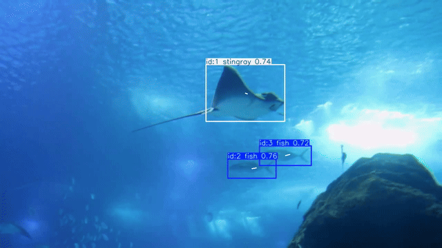
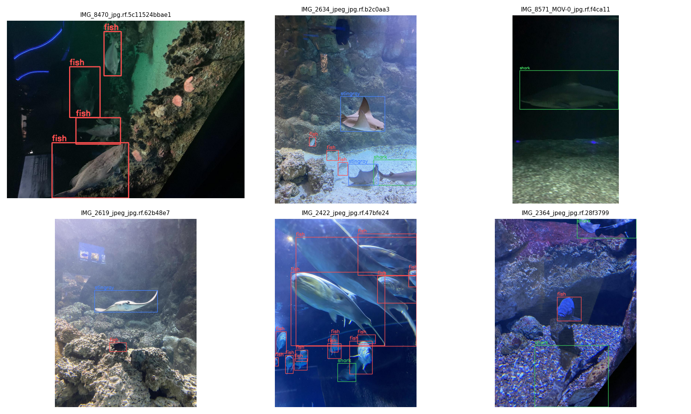
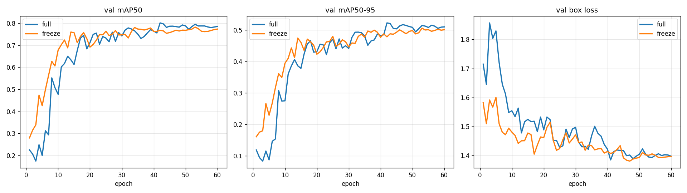
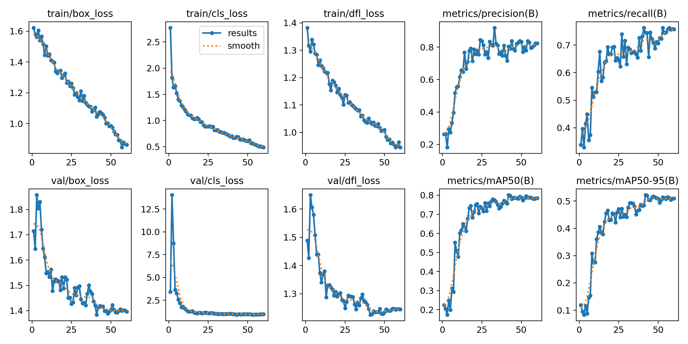
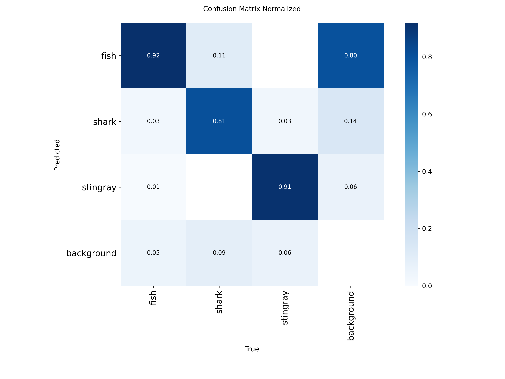
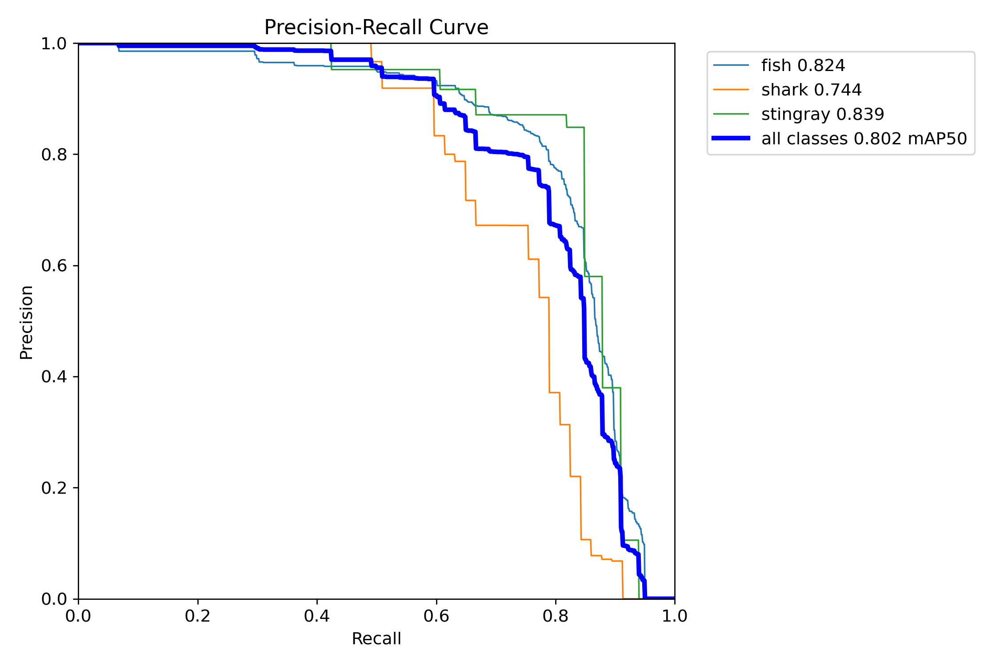
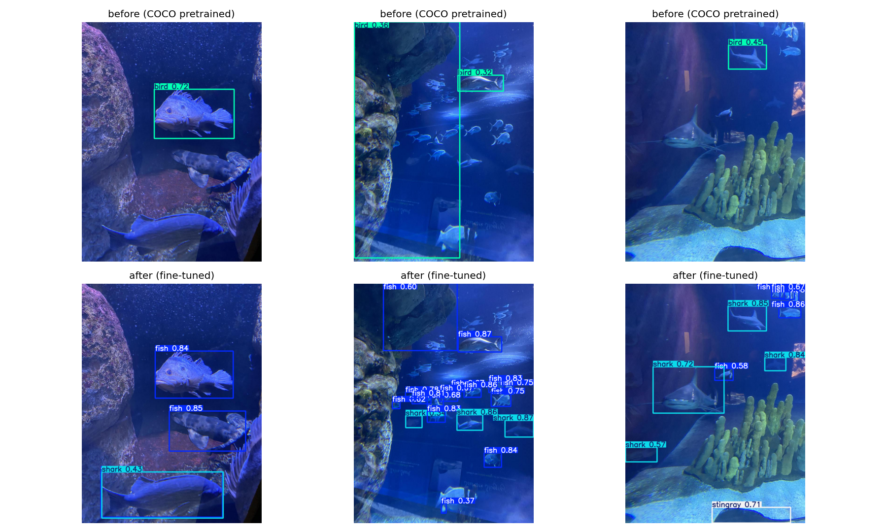

# YOLOv8 fine-tuning: 수족관 생물 3개 부류 감지·추적

머신러닝 과제 2의 결과 저장소입니다. COCO로 사전학습된 YOLOv8을 3개 부류(fish, shark, stingray)에 fine-tuning하고,
학습된 모델로 영상에서 객체를 감지·추적했습니다.

## 결과 영상



- 원본 화질 영상: [`videos/result_tracking.mp4`](videos/result_tracking.mp4) (5.0초)
- 상자 위의 숫자는 추적 ID이고, 흰 선은 최근 30프레임 동안의 이동 궤적입니다.
- 추적 알고리즘: `botsort.yaml`, confidence 임계값: 0.35
- 프레임별 추적 기록: [`results/tracks.csv`](results/tracks.csv)
- 영상 원본 출처: Pexels, Underwater Footage (Magda Ehlers), https://www.pexels.com/video/underwater-footage-2556894/

## 데이터

- 출처: [Roboflow Aquarium Combined](https://universe.roboflow.com/brad-dwyer/aquarium-combined/dataset/2) 버전 2 (CC BY 4.0)
- 원본 부류 7개(fish, jellyfish, penguin, puffin, shark, starfish, stingray) 중 3개를 선택해 부류 번호를 다시 매겼습니다.
- fish 부류는 상어와 가오리를 제외한 일반 어류를 가리키며, 데이터셋의 라벨 정의를 그대로 따랐습니다.
- 사용한 이미지: 총 408장 (train 297 / valid 77 / test 34)

| class | images | boxes | images_train | images_valid | images_test |
|---|---|---|---|---|---|
| fish | 333 | 2669 | 240 | 63 | 30 |
| shark | 176 | 354 | 134 | 28 | 14 |
| stingray | 124 | 184 | 91 | 23 | 10 |



## 학습

- 사전학습 가중치: `yolov8s.pt` (COCO)
- 설정: epochs 60 (patience 20), imgsz 640, batch 16, seed 0
- 환경: Ultralytics 8.4.216, Tesla T4
- 실험 `full`: 모든 층을 학습
- 실험 `freeze`: 백본(앞 10개 층)을 고정하고 넥과 헤드만 학습

| experiment | epochs_run | best_epoch | val_mAP50 | val_mAP50-95 | train_minutes |
|---|---|---|---|---|---|
| full | 60 | 42 | 0.801 | 0.522 | 6.4 |
| freeze | 60 | 53 | 0.782 | 0.506 | 5.5 |



## 성능 (test 분할)

| experiment | class | P | R | mAP50 | mAP50-95 |
|---|---|---|---|---|---|
| full | all | 0.901 | 0.712 | 0.835 | 0.566 |
| full | fish | 0.893 | 0.626 | 0.798 | 0.486 |
| full | shark | 0.826 | 0.711 | 0.780 | 0.539 |
| full | stingray | 0.986 | 0.800 | 0.926 | 0.672 |
| freeze | all | 0.810 | 0.706 | 0.818 | 0.512 |
| freeze | fish | 0.791 | 0.699 | 0.771 | 0.442 |
| freeze | shark | 0.725 | 0.711 | 0.783 | 0.501 |
| freeze | stingray | 0.914 | 0.708 | 0.901 | 0.592 |

최종 모델은 검증 mAP50-95가 더 높은 `full` 실험의 가중치이며 [`weights/best.pt`](weights/best.pt)에 있습니다.

아래의 학습 곡선, 혼동 행렬, PR 곡선은 학습 중 검증(valid) 분할로 계산한 것입니다.





## fine-tuning 전후 비교

윗줄은 COCO 사전학습 모델, 아랫줄은 fine-tuning한 모델의 예측입니다.



## 사용 방법

```python
from ultralytics import YOLO

model = YOLO("weights/best.pt")
model.track("my_video.mp4", tracker="botsort.yaml", conf=0.35, save=True)
```

## 파일 구성

- `weights/best.pt`: 학습된 모델
- `videos/`: 감지·추적 결과 영상 (mp4, gif)
- `results/`: 성능 지표, 학습 곡선, 혼동 행렬, 추적 기록
- `data.yaml`: 학습에 사용한 데이터 설정

## 참고 자료

- Ultralytics YOLO (AGPL-3.0): https://github.com/ultralytics/ultralytics
- 데이터셋: Roboflow Aquarium Combined (CC BY 4.0), https://universe.roboflow.com/brad-dwyer/aquarium-combined/dataset/2
- 영상: Pexels, Underwater Footage (Magda Ehlers), https://www.pexels.com/video/underwater-footage-2556894/
